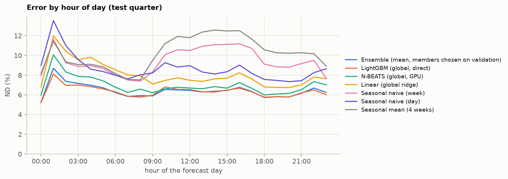
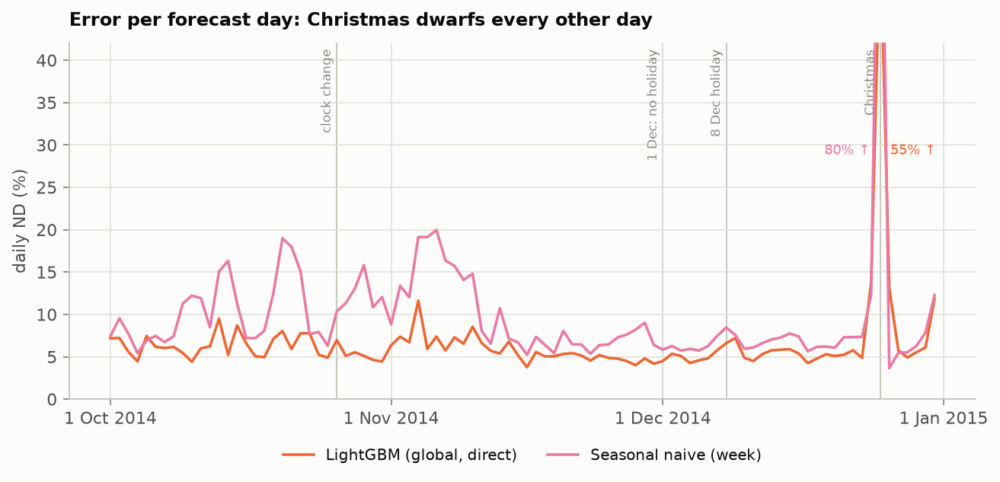
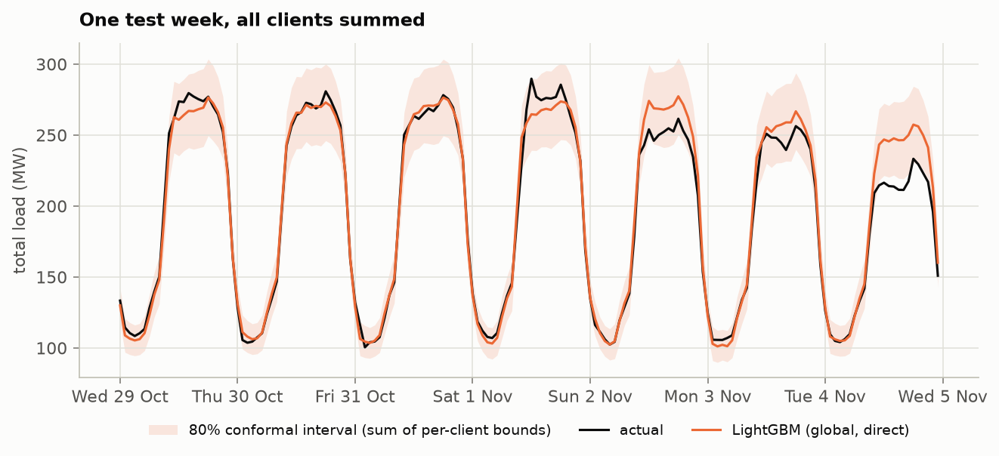

# electricity-load-forecasting

[](https://github.com/hoang-stack/electricity-load-forecasting/actions/workflows/ci.yml)


**Day-ahead forecasts of hourly electricity load for hundreds of clients, with honest
uncertainty.** Every midnight, each model predicts the next 24 hours for every client of the
[UCI ElectricityLoadDiagrams20112014](https://archive.ics.uci.edu/dataset/321/electricityloaddiagrams20112014)
dataset (Portugal, CC BY 4.0). The comparison covers seasonal baselines, a global linear model
solved in closed form, a global LightGBM, and N-BEATS on a GPU, and every model gets conformal
prediction intervals whose coverage is checked on unseen data.

It also tests a claim that has been debated since Zeng et al. (2023): on standard benchmarks,
deep forecasting models are often not better than a well-built linear model.

## Results

Test quarter: Q4 2014, 314 clients × 92 daily forecasts × 24 hours, scored once. The full
table, with NRMSE and validation ND, is in [reports/results.md](reports/results.md).

| Model | Test ND (95% CI) | MASE | Gap to LightGBM (paired 95% CI) |
| --- | ---: | ---: | ---: |
| **LightGBM (global, direct)** | **6.31%** (5.69–6.85) | 0.686 | – |
| Ensemble (LightGBM + N-BEATS, chosen on validation) | 6.34% (5.68–6.91) | 0.677 | +0.04 pp (−0.06 to 0.10) |
| N-BEATS (global, T4 GPU) | 6.79% (6.05–7.40) | 0.714 | +0.48 pp (0.28 to 0.62) |
| Linear (global ridge, 344 × 24 weights) | 7.77% (6.90–8.53) | 0.825 | +1.46 pp (1.17 to 1.71) |
| Seasonal naive (day) | 8.47% (7.85–9.00) | 0.999 | +2.16 pp (1.85 to 2.67) |
| Seasonal naive (week) | 9.60% (7.71–11.48) | 0.957 | +3.29 pp (1.86 to 4.68) |
| Seasonal mean (4 weeks) | 10.60% (8.18–13.19) | 0.991 | +4.29 pp (2.30 to 6.39) |

Prediction intervals, calibrated on the validation quarter. Width is the mean interval width
divided by the mean load.

| Interval | 80%: coverage on test | Width | 95%: coverage on test | Width |
| --- | ---: | ---: | ---: | ---: |
| Conformal, LightGBM | 80.0% | 0.214 | 94.9% | 0.492 |
| Conformal, ensemble | 79.8% | 0.211 | 94.8% | 0.479 |
| Conformal, N-BEATS | 79.7% | 0.222 | 94.8% | 0.500 |
| Conformal, linear | 79.9% | 0.265 | 94.8% | 0.602 |
| Conformal, seasonal naive (day) | 78.7% | 0.284 | 94.0% | 0.751 |
| LightGBM quantile regression (10% and 90%) | 75.7% | 0.167 | – | – |







## Protocol

- **Data:** 15-minute readings in kW, averaged to hourly, 2012–2014. Of 370 clients, the 56
  with more than 5% zero hours are dropped (they connected late or were switched off for long
  periods), which leaves 314.
- **Task:** at each midnight, forecast hours 00:00–23:00 of that day from the data available
  up to that midnight. Models may look back up to two weeks (336 hours).
- **Splits in time:** train until 30 June 2014, **validation** Q3 2014 (every choice:
  regularisation, early stopping, conformal calibration), **test** Q4 2014 (92 forecast days per
  client), scored once.
- **Metrics:** ND = Σ|error| / Σ|load|, the standard metric for this dataset since DeepAR.
  Also NRMSE, and MASE, which scales errors by the in-sample error of the weekly seasonal naive
  forecast. 95% CIs bootstrap *clients* (2,000 resamples), and model gaps use a paired
  bootstrap over clients.
- **Intervals:** split conformal prediction, using validation errors scaled by each client's
  level, separately per forecast hour. Compared with LightGBM quantile regression.

## Models

| Model | Idea |
| --- | --- |
| Seasonal naive (day / week) | Tomorrow = today, or the same day last week |
| Seasonal mean | Average of the same hour on the same weekday over the last 4 weeks |
| **Linear (global ridge)** ([linear.py](src/loadfc/linear.py)) | NLinear-style: scale by client level, subtract the last value, one ridge regression from the past 1 or 2 weeks + weekday to the next 24 hours, shared by all clients, solved in closed form (lookback and penalty chosen on validation) |
| **LightGBM (global, direct)** | One model for all clients and horizons: recent hours, same hour 1–2 days and 1–2 weeks ago, rolling statistics, calendar, client id. L1 objective |
| **N-BEATS** (Oreshkin et al., 2020) | Generic architecture: 6 residual MLP blocks with backcast/forecast over the past 1 or 2 weeks (chosen on validation), per-window level normalisation, trained on a T4 GPU, early-stopped on validation |
| Ensemble | Plain mean of the subset of {linear, LightGBM, N-BEATS} with the lowest validation ND |

## What the results say

1. **Boosted trees win. The linear model is not enough here, and neither is the deep model.**
   The global linear model beats every seasonal baseline with 8,256 numbers fitted in a couple of
   seconds, but LightGBM is 1.46 points of ND better and N-BEATS is about 1 point better. The
   "linear is all you need" debate (Zeng et al., 2023) is about long-horizon benchmarks scored by
   MSE on standardised series. On a day-ahead task across 314 heterogeneous clients, non-linear
   models win clearly. N-BEATS still trails LightGBM by 0.48 points, in line with the M5
   competition, where gradient-boosted trees beat deep models on heterogeneous series.
   LightGBM also used all 2,000 boosting rounds (validation was still improving), so its number
   is, if anything, an underestimate.
2. **Two weeks of history beat one, for every model that could choose.** Validation ND fell
   from 7.26% to 7.03% for the linear model and from 6.00% to 5.92% for N-BEATS. LightGBM's
   most useful features are the load at the same hour one week earlier, then one day earlier,
   then the client identity, then two weeks earlier.
3. **This data has almost no weekly cycle, and that decides which baseline is hard to beat.**
   Summed over clients, Sunday load is 1.7% below the weekly mean and Saturday's is 1.1% above
   (2012 to mid-2014). Half the clients have a weekend/weekday ratio between 0.98 and 1.02. So
   "same hour yesterday" (8.47%) beats "same hour last week" (9.60%), and four-week weekday
   averages are the worst baseline.
4. **The ensemble chosen on validation did not help on test.** The mean of LightGBM and N-BEATS
   had the lowest validation ND (5.57% against 5.60%). On test it is 0.04 points worse than
   LightGBM alone, well inside the noise. A 0.03-point validation edge is not evidence.
5. **Conformal intervals hit their nominal coverage; the model's own quantiles do not.** The
   conformal intervals of all seven models land within 1.5 points of 80% and 95%. LightGBM's quantile regression
   covers 75.7% instead of 80%: it is fitted on the training period, so its spread reflects
   in-sample residuals, which are smaller than errors on new data. Conformal prediction
   calibrates on held-out residuals instead.
6. **Coverage is only guaranteed on average.** Over all 693,312 test hours, the 80% interval
   around LightGBM covers 80.0%. On Christmas Day it covers 32.8%, and on Christmas Eve 59.3%.
   By hour of day it ranges from 76.6% (01:00) to 82.6%. By client, the worst tenth get 61% or
   less and the best tenth 92% or more, and 21% of clients get under 70%. The interval is one
   error quantile per hour, scaled by the client's level, so noisy clients are under-covered
   and steady ones over-covered. Per-group (Mondrian) conformal prediction or a model of each
   client's error scale would address this.
7. **Errors concentrate on a few days and one hour.** The median daily ND is 5.5%. On Christmas
   it is 55% for LightGBM and 80% for the weekly naive forecast, because load was 34% below
   LightGBM's forecast. The next worst days are 24, 26 and 31 December. 1 December was not a
   public holiday in 2014 (suspended from 2013 to 2015) and shows no spike.
   01:00 is the hardest hour, and part of that is an artefact of the dataset: on the October
   clock change (26 October 2014) the 01:00 slot holds two hours of consumption, so the total
   load in that slot is 2.2 times a normal night. Excluding that one day lowers LightGBM's ND
   at 01:00 from 8.11% to 7.12%, but 01:00 stays the hardest hour of the night. The quarter's
   overall ND moves by 0.01 points, and the data are kept as published.

## Quickstart

```bash
git clone https://github.com/hoang-stack/electricity-load-forecasting.git
cd electricity-load-forecasting
python -m venv .venv && source .venv/bin/activate
pip install -e ".[dev]"
pytest                                   # unit tests on synthetic series
```

The experiment runs as a Kaggle notebook ([kaggle/forecast.py](kaggle/forecast.py)). It
downloads the data from UCI itself, and needs a dataset containing `src/loadfc` plus a T4 GPU.
Copy `kaggle/kernel-metadata.example.json` to `kernel-metadata.json`, set your username, and run
`kaggle kernels push -p kaggle --accelerator NvidiaTeslaT4`. Then download `forecasts.npz`,
`metrics.json`, `clients.json` and `lightgbm_quantiles.npz` to `kaggle/output/main/`, and run
`loadfc report`. The full run took 54 minutes; most of it is LightGBM on 6.8 million rows
on the CPU, while N-BEATS trains in under two minutes per lookback on the T4.

The trained global linear model is a 344 × 24 matrix
([artifacts/linear_weights.npy](artifacts/linear_weights.npy), 33 KB).
`loadfc forecast history.txt --weekday 0` forecasts the next 24 hours of any series from its
last 336 hourly values (one per line), without PyTorch or a GPU.

## Project layout

```text
src/loadfc/
├── windows.py      forecast origins and (input, target) windows from a time x series matrix
├── baselines.py    seasonal naive and seasonal mean
├── linear.py       global NLinear-style ridge regression, solved by streaming normal equations
├── metrics.py      ND, NRMSE, MASE, client bootstrap, interval coverage and width
├── conformal.py    split conformal intervals per horizon with finite-sample correction
├── report.py       tables and figures from the Kaggle outputs
└── cli.py          `loadfc report | forecast`
kaggle/forecast.py  data download, all models (LightGBM, PyTorch N-BEATS on GPU), intervals
```

## Limitations

- **One dataset, one test quarter.** Q4 contains Christmas, and every model is worse on test
  than on the validation quarter (Q3). Other quarters would give other numbers.
- **ND weights clients by their load**, so large clients dominate. Per-client ND has a median of
  6.1%, a 90th percentile of 11% and a worst case of 53%.
- **Little tuning.** LightGBM hit its 2,000-round cap; N-BEATS ran with one seed, with only the
  lookback and early stopping tuned. No model got a wider hyperparameter search.
- **No exogenous inputs** such as temperature or a holiday calendar. A holiday flag is the
  obvious next feature: Christmas 2012 and 2013 are in the training data.
- **The validation quarter does two jobs.** It is used to tune (ridge penalty, lookbacks, early
  stopping, ensemble members) and to calibrate the conformal intervals. Strictly, calibration
  data should be untouched; measured test coverage is on target, so the effect is small here.
- **Split conformal assumes exchangeable errors.** Errors in summer (Q3) and autumn (Q4) are not
  exchangeable, and coverage holds only on average (point 6).
- Clock-change artefacts in the raw data are kept as published.

## References

- Trindade, A. (2015). ElectricityLoadDiagrams20112014. UCI Machine Learning Repository.
- Zeng, A., Chen, M., Zhang, L., Xu, Q. (2023). Are Transformers effective for time series forecasting? *AAAI.*
- Oreshkin, B. et al. (2020). N-BEATS: neural basis expansion analysis for interpretable time series forecasting. *ICLR.*
- Salinas, D. et al. (2020). DeepAR: probabilistic forecasting with autoregressive recurrent networks. *IJF.*
- Hyndman, R., Koehler, A. (2006). Another look at measures of forecast accuracy. *IJF.*
- Ke, G. et al. (2017). LightGBM: a highly efficient gradient boosting decision tree. *NeurIPS.*
- Lei, J. et al. (2018). Distribution-free predictive inference for regression. *JASA.*
- Makridakis, S., Spiliotis, E., Assimakopoulos, V. (2022). M5 accuracy competition: results, findings, and conclusions. *IJF.*
